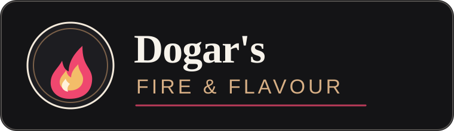

<div align="center">




**Open-source, self-hosted restaurant POS & management system** — billing
with **UPI QR payments**, tables, kitchen display (KDS), reservations,
inventory, **staff attendance & payroll**, accounting, reports, CRM/loyalty
and multi-branch control. Offline-first, runs on your own server, no
subscription. Not a retail POS bolted onto a restaurant; purpose-built for
dine-in, takeaway, delivery and kitchen operations.

The cashier and kitchen screens require the restaurant's server and local
network to be available. If that server is down, client devices do not queue
orders for later sync.

[](package.json)
[](pnpm-workspace.yaml)
[](apps/web/tsconfig.json)
[](apps/backend)
[](apps/web)
[](casaos/README.md)
[](./CONTRIBUTING.md)
[](./ROADMAP.md)

Developed by [Komyosys](https://komyosys.com/)

**[Try Dogar's Fire & Flavour](https://dogerfastandfire.com/)** · **[Case study](https://komyosys.com/projects/doger)** · **[Maintainer: Komyosys](https://komyosys.com/)**

</div>

---

## What this is

**Dogar's Fire & Flavour** is a purpose-built, offline-first Restaurant
Management System for restaurants, cafés, coffee shops, bakeries, fast
food, fine dining, bars, food courts, cloud kitchens, and multi-branch
chains. The whole stack — Postgres, API, and web app — runs on one local
server on the restaurant's own LAN: order-taking, billing, KDS, and
printing all keep working with the WAN cable unplugged. No subscription,
no forced cloud dependency, self-hosted by design.

It's powered by **Komyosys**.

## Where to run it

"Offline-first" describes how the app runs, not where it has to live —
nothing about it is tied to a specific machine or network:

- **A local LAN server (the default, recommended setup).** One machine in
  the restaurant runs `docker compose up`; every till, tablet, and KDS
  screen on the same Wi-Fi/Ethernet reaches it at `http://<that machine's
  LAN IP>:2006`. No internet connection is needed once it's running —
  order-taking, billing, KDS, and printing all keep working with the WAN
  cable unplugged.
- **Any VPS or cloud box.** The identical `docker compose up` also runs
  unmodified on a VPS (DigitalOcean, Hetzner, AWS, etc.) if you'd rather
  manage one restaurant — or several branches — remotely instead of on
  site. Point `FRONTEND_ORIGIN`/`HOST_PORT` in `.env` at that box instead
  of `localhost`; nothing else changes.
- **Behind a tunnel (Cloudflare Tunnel, ngrok, Tailscale Funnel, or any
  reverse proxy).** Reachable from outside the LAN with a real HTTPS
  certificate and no port-forwarding, by pointing the tunnel at the `web`
  service's port (`2006` by default). Once traffic reaches the app over
  `https://`, set **`COOKIE_SECURE=true`** in `.env` so the session cookie
  is marked `Secure`. Use HTTPS for any public VPS access. The default
  `COOKIE_SECURE=false` is for localhost or a trusted private LAN only.

Whichever way you reach it, it's the same three containers, same data, same
login — there's no separate "cloud" mode to configure.

### Windows desktop client

However you host the server above, tills that are Windows machines don't
have to use a browser tab: `windows/msix/` packages a thin native client
(WinForms + WebView2, not Electron — no bundled Chromium, no server, no
Docker) with a Start Menu entry that points at your server's address and
otherwise just shows the same web UI. See
`windows/msix/README.md` for what it is/isn't, build instructions, and the
full capability list.

## Features

| | Module | Status |
|---|---|---|
| 1 | POS & Billing — dine-in/takeaway, bill merge, multi-region tax (India GST, US Sales Tax, EU VAT, Spain IVA), discounts, gift cards, tips, payments, refunds | ✅ |
| 2 | Table & Reservation Management — visual floor plan, booking, waitlist, QR table ordering, table transfer | ✅ |
| 3 | Kitchen Management (KDS) — display, KOTs, multi-station routing, prep tracking, performance reporting | ✅ |
| 4 | Menu Management — categories, modifier groups, combos, seasonal menus, availability scheduling | ✅ |
| 5 | Inventory & Store Management — ingredients, recipe costing, POs, suppliers, GRN, waste, batch/lot | ✅ |
| 6 | Procurement — vendor quotations, purchase requests/orders, invoices, supplier payments | ✅ |
| 7 | CRM — profiles, loyalty points, gift vouchers, feedback, visit history | ✅ |
| 8 | Staff Management — accounts & roles, attendance, shift scheduling, leave, payroll | ✅ |
| 9 | Accounting — expenses, cash close with variance, profit & loss, balance sheet, budgets | ✅ |
| 10 | Delivery Management — zones by pincode, fee/minimum/ETA, driver assignment, status flow | ✅ |
| 11 | Online Ordering — public website, QR table ordering with modifiers, call waiter, request bill | ✅ |
| 12 | Branch Management — branch switcher, cross-branch overview, stock transfers | ✅ |
| 13 | Analytics — live dashboard plus reports (peak hours, food cost & margins, retention…) with print, CSV, Excel and PDF export | ✅ |
| 14 | Marketing — coupons, happy-hour discounts, email / SMS / WhatsApp campaigns with opt-out | ✅ |
| 15 | Security — RBAC, audit log, two-factor sign-in with recovery codes, backup/restore, session expiry, PIN login | ✅ |
| 16 | Integrations — UPI QR payments, customer-facing second screen, direct-USB ESC/POS printing + cash drawer, signed webhooks, SMTP email, REST/Swagger and API & MCP server | ✅ |
| 17 | Admin Panel — restaurant/branch settings, per-branch tax regime, UPI payee, roles, permissions | ✅ |

## How to use Dogar's Fire & Flavour

1. **Set up your restaurant.** Create the owner account, then enter your
   restaurant details, branch address, currency, timezone, tax settings, and
   UPI payee in **Settings**.
2. **Add the menu and floor.** Create categories, dishes, options and combos;
   add floors and tables. Add ingredients and recipes if you want stock usage
   and food cost tracked automatically.
3. **Take an order.** In **Point of Sale**, choose dine-in, takeaway, or
   delivery, add dishes and modifiers, then send the order to the kitchen.
4. **Prepare and collect payment.** The **Kitchen Display** updates live.
   At checkout, take cash, card, or UPI; for UPI, the app shows a QR code for
   the exact amount. Confirm the payment in your UPI app before completing the
   sale.
5. **Run the shift.** Use **Tables**, **Reservations**, **Customers**,
   **Inventory**, **Team**, and **Reports** to manage the floor, regulars,
   stock, staff, and daily close.
6. **Enable online ordering.** In **Settings > Public Website**, enable the
   public menu so customers can place takeaway/delivery orders from outside
   the restaurant. Orders arrive as online orders waiting for staff to accept
   on the Kitchen Display.

## Tech stack

| Layer | Choice |
|-------|--------|
| Monorepo | pnpm workspaces + Turborepo |
| Backend | NestJS (TypeScript), REST `/api/v1`, Swagger at `/api/docs` |
| ORM / DB | Prisma + PostgreSQL |
| Realtime | Socket.IO (NestJS gateway) — tables, KDS tickets, QR-order status |
| Frontend | Next.js (App Router) + TypeScript + Tailwind v4 |
| UI components | shadcn/ui (Base UI primitives) |
| Data fetching | TanStack Query |
| Tables | TanStack Table |
| Charts | Recharts |
| i18n | Lightweight client-side context — English/Spanish/French |
| Auth | JWT (httpOnly cookie) + PIN quick-switch, optional TOTP 2FA |
| Containers | Docker + Docker Compose |

## Quick start

### Installing Docker

Skip this if `docker --version` already works. Otherwise:

**Windows 10/11** — Use WSL2 with Docker Engine (see `scripts/quickstart.ps1`):

```powershell
irm <quickstart-script-url> | iex
```

**Linux** (Debian/Ubuntu/Fedora/etc.):

```bash
curl -fsSL https://get.docker.com | sudo sh && sudo usermod -aG docker $USER
```

Log out and back in so your user can run `docker` without `sudo`.

### One-click install

```bash
docker compose up -d --build
```

Before the first run, copy `.env.example` to `.env` and replace both secret values with long random values. Docker serves the app on **http://localhost:2006**. Set `HOST_PORT` in `.env` to change that host port. The development web app uses **http://localhost:3030** (`DEV_PORT` in `.env`).

To load the local database with the Dogar's starter restaurant, PKR menu,
tables, staff roles, and sample orders, run this once after Docker is up:

```bash
docker compose --profile seed run --rm seed
```

This starter seed is for a local development database. It creates the demo
owner login `owner@demo.local` / `Password123!` and sample operational records;
change the password and review the menu, tax settings, and stock counts before
using any database for real service. The seed refuses remote database hosts by
default. Supabase production data is not seeded automatically.

### Manual install

```bash
cp .env.example .env        # replace JWT_SECRET and POSTGRES_PASSWORD before starting
docker compose up -d --build
```

### Supabase PostgreSQL

[`supabase_schema.sql`](./supabase_schema.sql) is a generated schema export for a **new, empty** Supabase database. Generate it with `.\build-schema.ps1`, run it once in the Supabase SQL Editor, then run every `prisma migrate resolve --applied <migration-name>` command printed by the script before starting the backend. This records the migrations already represented by the imported schema; without it, `prisma migrate deploy` cannot safely determine which migrations have run.

Use Supabase's **direct PostgreSQL connection** (normally port `5432`) for these migration commands, not its transaction pooler (normally port `6543`). Set `SUPABASE_DATABASE_URL` in the root `.env` to the Supabase Postgres connection string to make Docker use it; leave it blank to use the included local PostgreSQL container. Restore the transaction-pooler URL with `pgbouncer=true` for runtime if that is what the backend uses. Do not apply this schema export to a database that already contains application tables or data.

This configures the PostgreSQL database only. Supabase Auth/Storage integration
and local SQLite/IndexedDB offline sync are separate implementation phases in
[`DOGARS_REDESIGN_AND_OFFLINE_PLAN.md`](./docs/DOGARS_REDESIGN_AND_OFFLINE_PLAN.md).

### Local development

Requires Node 22+ and pnpm. Copy the root `.env.example` to `.env`, then set
`SUPABASE_DATABASE_URL` to your Supabase Postgres connection string. The dev
launcher loads that same file for both apps and maps the Supabase URL to the
current Prisma backend. Use `DATABASE_URL` instead if you run local PostgreSQL.

```bash
pnpm install
docker compose up -d postgres  # only when using local PostgreSQL
pnpm --filter @nodedr-restaurant/types build
pnpm dev   # backend :4001, web :3030
```

For Supabase, run the repository's documented Prisma schema setup first; local
PostgreSQL requires applying migrations and seeding from `apps/backend`.

## Documentation

| Doc | What's in it |
|-----|--------------|
| [`PROJECT.md`](./PROJECT.md) | Source of truth — full vision, complete scope, current status |
| [`ARCHITECTURE.md`](./ARCHITECTURE.md) | Tech-stack decisions and reasoning |
| [`ROADMAP.md`](./ROADMAP.md) | Phased build plan / living TODO |
| [`DESIGN_SYSTEM.md`](./DESIGN_SYSTEM.md) | Visual language, tokens, component inventory |
| [`casaos/README.md`](./casaos/README.md) | CasaOS/ZimaOS one-click install |
| [`windows/msix/README.md`](./windows/msix/README.md) | Windows MSIX desktop client |
| [`ACCESSIBILITY.md`](./ACCESSIBILITY.md) | WCAG 2.1 AA target and testing |
| [`COMPLIANCE-INDIA.md`](./COMPLIANCE-INDIA.md) | DPDP Act 2023, IT Rules, GST invoicing |
| [`docs/verifactu.md`](./docs/verifactu.md) | Spain VERI*FACTU compliance |
| [`SECURITY-AUDIT-REPORT.md`](./SECURITY-AUDIT-REPORT.md) | Security audit findings |
| [`docs/KIOSK-AND-KDS.md`](./docs/KIOSK-AND-KDS.md) | Kiosk and KDS setup |
| [`docs/integrations-api.md`](./docs/integrations-api.md) | MCP server and public integration REST API |
| [`docs/DOGARS_REDESIGN_AND_OFFLINE_PLAN.md`](./docs/DOGARS_REDESIGN_AND_OFFLINE_PLAN.md) | Dogar’s reference UI, complete page map, offline sync, and delivery phases |
